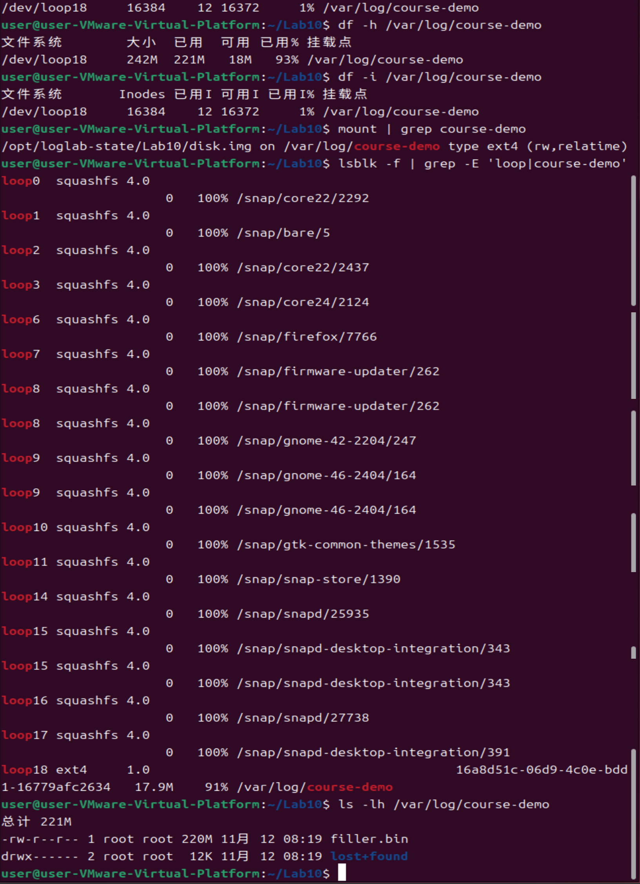
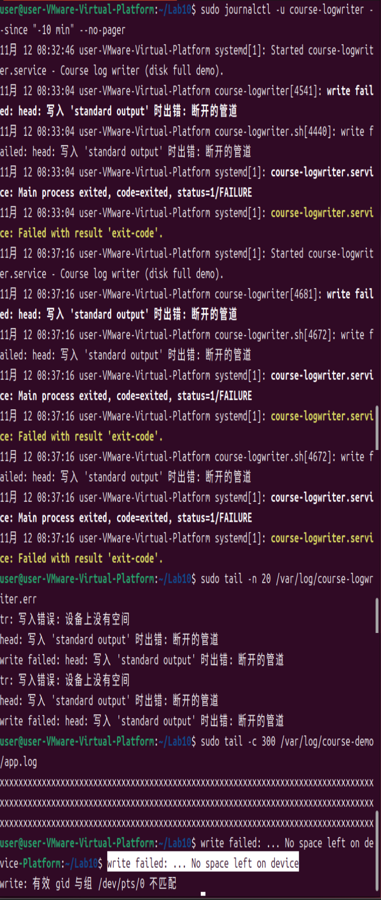
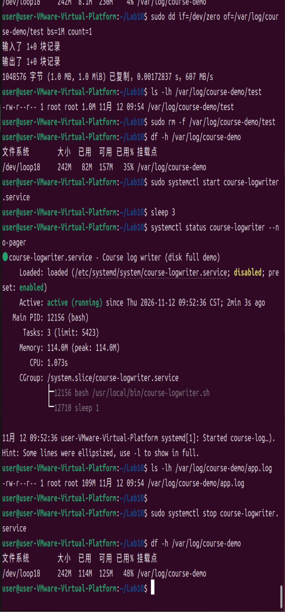

# Lab10：文件系统空间耗尽与日志写入故障分析

> 前置实验：Lab3（日志文件与轮转）、Lab5（Alloy 采集）、Lab7（时间线与 4W1R）、Lab9（日志缺失与故障定位）。  
> 建议用时：120 分钟（实验操作与证据收集；报告可课后完善）。  
> 截止时间：**2026-11-19 23:59:59（北京时间）**。

---

## 引言：日志为什么会成为故障的原因？

前面的实验主要关注**日志能不能被记录、采集和查询**。例如，日志轮转或者采集器异常，可能让 Loki 中的一段记录消失。Lab10 讨论另一种情况：**日志一直能写入，却因为持续增长，最终把存放它的文件系统写满了。**

正常情况下，应用程序不断向日志文件追加内容，操作系统为这些数据分配磁盘空间。当可用空间耗尽时，写入可能失败，应用收到 `No space left on device` 错误；如果程序没有办法继续工作，systemd 还会记录服务的异常退出。

但单独看到这条错误，还不能说明故障的全貌。我们至少需要回答四个连续的问题：

1. **哪里满了？** 是哪个文件系统？它还有多少可用空间？
2. **为什么满了？** 哪些文件占用了空间？是数据块耗尽，还是 inode 耗尽？
3. **造成了什么影响？** 哪个服务写入失败？本机和 Loki 中能找到哪些证据？
4. **怎样确认修好了？** 空间释放之后，除了测试磁盘可写，原来的服务能否重新写日志？

本实验围绕这四个问题展开。脚本会创建一个约 **256MB 的 loop 文件系统**，将其挂载到 `/var/log/course-demo`，预先放入约 **220MB 的 `filler.bin`**（模拟遗留备份文件），再通过 `course-logwriter.service` 每秒向 `app.log` 写入约 1MB，直到发生真实的空间不足错误。学生需要观察现象、收集证据、定位原因、修复并验证。

**整条主线是：文件占用增加 → 文件系统可用空间减少 → 写入失败 → 服务异常 → 本机与平台定位 → 释放空间 → 验证服务恢复。** 后文出现的命令都服务于这条主线。

---

## 〇、实验说明与提交方式

### 0.1 运行环境与安全要求

- **仅在课程虚拟机中实验**，不要在日常使用的计算机或生产服务器上执行。
- 开始前创建虚拟机快照。
- 必须使用课程提供的 `setup.sh`、`restore.sh` 和 `lablib.sh`。**不修改三个脚本，也不需要自行编写其他脚本。**
- `setup.sh` 只准备文件系统和写入服务，**不会启动写入器**。任务 1 需要先记录写满前的状态；到任务 2 再手动启动。
- loop 镜像文件位于 `/opt/loglab-state/Lab10/disk.img`，占用宿主文件系统一定空间。虽然实验写满的是 loop 文件系统，也要保证虚拟机根分区有足够剩余容量。
- `restore.sh` 用来停止服务、卸载并清理实验文件系统。执行后，`/var/log/course-logwriter.err`、`/var/log/syslog` 和 Loki 中的历史记录预计仍保留，供复盘使用。

### 0.2 报告准备

在课程仓库的个人提交目录中执行：

```bash
cd 学号姓名
```

> **作用：** 进入自己的提交目录（把 `学号姓名` 替换成真实目录名，例如 `2024010001赵宇轩`），后续报告和截图都放在这里。

```bash
mkdir -p Lab10/imgs
```

> **作用：** 创建 `Lab10/` 以及其中的 `imgs/` 截图目录；`-p` 让父目录不存在时一并创建，目录已存在也不报错。

```bash
cp ../homework/Lab10/Lab10.md Lab10/Lab10.md
```

> **作用：** 把题目模板复制到自己的 `Lab10/` 目录中，之后只修改这份副本，题目目录里的模板保持原样。

在**复制后的 `Lab10/Lab10.md`** 中填写本人实验数据。`homework/Lab10/` 中的题目模板和脚本不要修改。

**填写原则：**保留本实验的题目、命令、表格及截图位置，在标有“答：”“填写：”的地方记录实际值。预期输出仅用于对照，不能直接当作个人实验结果。若结果不同，应写出观察到的差异及分析。

提交内容：**1 份 Markdown 报告、4 张截图**。截图名称及位置保持不变，见第十节；不要把三个脚本复制到提交目录。

### 0.3 前置环境检查

本实验延续 Lab5 的日志采集平台。先检查：

```bash
systemctl is-active loki grafana-server alloy rsyslog
```

> **作用：** 一次性查询四个服务的活动状态，正常时应输出四行 `active`；只要有一个不是 `active`，后面的 Loki 查询或 syslog 采集就无法完成。

```bash
curl -sS http://127.0.0.1:3100/ready
```

> **作用：** 请求 Loki 的就绪探针接口；`-sS` 表示静默模式但保留错误提示。输出 `ready` 说明 Loki 已能接受查询，`ingester` 等状态异常时会返回其他内容。

前四个服务应显示 `active`，Loki 的 `/ready` 应显示 `ready`。如果平台尚未恢复，先处理 Lab5 环境，否则后面的 Loki 查询无法完成。

这里先明确三个日志的位置，避免后面混淆：

| 位置 | 本实验中的作用 |
| :--- | :--- |
| `/var/log/course-demo/app.log` | 写入器持续追加的应用日志，位于**会被写满的 loop 文件系统**中 |
| `/var/log/course-logwriter.err` 和 systemd journal | 观察写入服务失败原因的**本机证据** |
| `/var/log/syslog` → Alloy → Loki | 写入器通过 `logger` 报告失败后，进入集中日志平台的**平台证据** |

**注意：**`app.log` 不在本实验预先配置的 Alloy 采集路径中。Loki 中查询的是 `logger` 发往 syslog 的故障信息，而不是 `app.log` 的内容。

---

## 一、实验目标与诊断思路

完成实验后，应能够：

1. 通过 `df -h` 判断**文件系统的块空间**是否耗尽，通过 `df -i` 判断是否存在 **inode 耗尽**。
2. 通过 `du -sh` 与 `ls -lh` 找出主要空间占用，并解释它们和 `df` 的统计对象为什么不同。
3. 结合 `No space left on device`、`systemctl`、`journalctl` 判断日志写入失败与服务状态的关系。
4. 理解文件删除与空间释放不总是同时发生，并知道何时使用 `lsof +L1`。
5. 结合本机证据与 Loki 的 syslog 记录，完成一条**有时间、有位置、有进程、有结果**的故障时间线。
6. 在释放空间之后验证文件系统和写入服务均已恢复，并提出预防措施。

实验按照“**观察—解释—定位—修复—验证**”的顺序进行：

| 阶段 | 要解决的问题 | 主要证据 |
| :--- | :--- | :--- |
| 任务 1：记录初始状态 | 文件系统在哪里？原来有多少空间？ | `mount`、`df`、`ls` |
| 任务 2：触发故障 | 空间耗尽后，写入和服务发生了什么？ | `df`、`systemctl`、`journalctl`、`dd` |
| 任务 3：查找原因 | 哪些文件造成占用？错误能否被平台观测到？ | `du`、`df -i`、`lsof`、Loki |
| 任务 4：修复验证 | 释放空间后，文件写入和服务运行是否恢复？ | `df`、`dd`、`systemctl`、`app.log` |

---

## 二、实验前必须理解的基础知识

这一节只介绍理解主线所必需的概念。关于“已删除文件仍占空间”和“日志轮转”的进一步问题，会分别在任务 3 与第九节结合实际情况解释。

### 2.1 文件为什么会占用空间：块与 inode

可以把文件系统理解为一本账：**数据存在哪里**，以及**文件是什么**，是两类不同的信息。

- **数据块（block）**：存放文件内容。日志越来越大，主要消耗的是数据块。
- **inode**：存放文件的元信息，例如权限、大小及数据块位置。创建新文件通常需要可用 inode。

因此，`No space left on device` 不一定只有一种成因：可能是**可用数据块耗尽**，也可能是在创建文件时**没有可用 inode**。这两种情况都需要检查，但本实验预设的是前者。

| 命令 | 统计对象 | 在本实验里回答什么问题 |
| :--- | :--- | :--- |
| `df -h 路径` | 路径所在**整个文件系统**的空间使用情况 | 这个文件系统是否已经满了？ |
| `df -i 路径` | 路径所在文件系统的 inode 使用情况 | 新建文件是否可能受 inode 数量限制？ |
| `du -sh 路径` | 指定文件或目录下**可遍历文件**的实际块占用 | 空间主要被哪个文件或目录占用了？ |
| `ls -lh 文件` | 文件的**逻辑大小** | 文件看起来有多大？ |

例如：`df -h /var/log/course-demo` 显示整个文件系统的使用情况；`du -sh /var/log/course-demo/*` 则逐个显示目录中可见文件占用的空间。

**先看 `df`，再看 `du`。** 因为只有先确认哪个文件系统满了，按文件查占用才有明确范围。

还要知道：`df` 读取文件系统提供的空间统计信息；`du` 遍历目录中的文件并累计其块占用。文件系统元数据、已删除但仍打开的文件等，可能使两者不完全一致。`du` 默认可能跨越子目录中的其他挂载点；需要限制为单一文件系统时可使用 `du -x`。本实验目录结构简单，后续直接按文件统计即可。

### 2.2 为什么使用 loop 文件系统

要观察“磁盘从没满到写满”，就必须有一块可以安全消耗的存储空间。我们不直接写满虚拟机根分区，而是用一个普通文件模拟小型磁盘：

```text
/opt/loglab-state/Lab10/disk.img
             │ 作为块设备使用（loop）
             ▼
        /dev/loopN
             │ 挂载 ext4 文件系统
             ▼
      /var/log/course-demo
             ├── filler.bin   （预置旧备份）
             └── app.log      （任务 2 启动后逐渐增长）
```

`disk.img` 约 256MB，被格式化为 ext4 后挂载到 `/var/log/course-demo`。`mount`、`lsblk` 能帮助我们确认这两个名字实际对应同一个文件系统。实验写入器只向这个挂载点写入，避免直接向根分区制造空间耗尽故障。

**由此得出任务 1 的判断顺序：**先用 `mount` 确认观察对象，再用 `df` 查看容量，最后用 `ls` 看初始文件。

### 2.3 文件系统写满，为什么会变成服务故障

文件的增长最终由程序发起写入请求。以本实验为例：

```text
course-logwriter.service
        │ 写入 app.log
        ▼
  应用发起写入请求
        │
        ▼
  ext4 尝试分配数据块
        │ 可用块不足
        ▼
   写入返回 ENOSPC
        │
        ▼
  No space left on device
        │
        ▼
 写入器记录故障并退出
        │
        ▼
 systemd 记录 failed 状态
```

`ENOSPC` 是与空间不足相关的错误码；`No space left on device` 是常见的人类可读错误信息。某次写入可能只成功写入部分内容，也可能直接失败，因此文件末尾有时会出现不完整记录。

这条链还解释了为什么我们需要多个证据来源：

- `df` 用来证明文件系统空间确实耗尽；
- `systemctl` 用来证明服务已经失败；
- `journalctl` 和 `.err` 用来查看服务报告的具体错误；
- `dd` 用独立的写入操作检查问题是否也影响其他写入者。

**只看到 `failed` 不等于证明磁盘满；只看到 `df` 100% 也不等于证明某个服务因此退出。两类证据需要相互对应。**

---

## 三、任务 1：准备环境，记录写满之前的状态

在真正制造故障之前，必须有一份正常状态下的记录。否则，任务 2 中看到 `100%` 时，就无法比较它是如何变化的。

### 3.1 上传并运行 `setup.sh`

课程仓库的三个脚本必须放在同一个目录中。先在虚拟机中创建目录：

```bash
mkdir -p ~/Lab10
```

> **作用：** 在虚拟机自己的家目录下建立 `~/Lab10`，用来集中存放 `setup.sh`、`restore.sh`、`lablib.sh` 三个脚本。

在 **Windows 课程仓库根目录的 Git Bash** 中执行（按实际情况替换用户名和 IP）：

```bash
scp ./homework/Lab10/setup.sh ./homework/Lab10/restore.sh ./homework/Lab10/lablib.sh 用户名@虚拟机IP:~/Lab10/
```

> **作用：** 用 `scp` 把三个脚本一次性从 Windows 上的课程仓库复制到虚拟机家目录的 `~/Lab10/` 中；三个脚本必须放在同一个目录，`lablib.sh` 才能被另外两个脚本引用。

在虚拟机中执行：

```bash
cd ~/Lab10
```

> **作用：** 切换工作目录到脚本所在位置，保证下面可以用相对路径执行脚本。

```bash
ls -l
```

> **作用：** 确认三个脚本都已上传、文件名正确，并留意它们是否带有执行权限（`-rwxr-xr-x`）。

```bash
sudo bash setup.sh
```

> **作用：** 以 root 权限运行准备脚本，完成 loop 镜像创建、ext4 格式化、挂载、写入 `filler.bin` 以及安装 `course-logwriter.service`；此步骤**不会**启动写入器。

若仓库目录与示例不同，调整 `scp` 源路径；上传到 `~/Lab10` 后，后续操作不变。

`setup.sh` 按预设完成以下事情：

1. 检查 Loki、Grafana、Alloy 与 rsyslog 服务状态；
2. 备份可能已有的 `course-logwriter.service` 和写入脚本；
3. 创建约 256MB 的 `disk.img`，使用 `mkfs.ext4 -b 1024 -i 16384 -m 0` 格式化，挂载到 `/var/log/course-demo`；
4. 放入约 220MB 的 `filler.bin`，模拟遗留备份文件；
5. 安装 `course-logwriter.service`，每秒向 `app.log` 写入约 1MB；失败时向 `.err` 写入错误，并调用 `logger` 报告到 syslog；
6. 输出文件系统当前状态，**暂不启动写入器**。

其中，`-m 0` 使这个实验文件系统不保留默认的 root 预留块，方便稳定触发空间不足；生产环境是否保留预留空间另当别论。

输出示例（设备号与容量可能不同）：

```text
[Lab10] 已创建并挂载 256MB loop 文件系统：/var/log/course-demo
[Lab10] 已放入 220MB 的 filler.bin。
[Lab10] 已创建 course-logwriter.service，但尚未启动。
[Lab10] 下一步：在任务 2 执行 sudo systemctl start course-logwriter.service
[Lab10] 当前状态（写入器启动前）：
Filesystem      Size  Used Avail Use% Mounted on
/dev/loop0      256M  235M   22M  92% /var/log/course-demo
Filesystem     Inodes IUsed IFree IUse% Mounted on
/dev/loop0       16384    12 16372    1% /var/log/course-demo
```

### 3.2 检查挂载、空间与文件

先看容量：

```bash
df -h /var/log/course-demo
```

> **作用：** 查看该路径所在**文件系统**的总容量、已用、可用和 `Use%`，判定它是否已接近写满（本实验期望低于 100%）。

```bash
df -i /var/log/course-demo
```

> **作用：** 查看同一文件系统的 **inode** 使用情况；`IUse%` 很低说明问题不在“文件数量太多”，而在数据块。

```bash
mount | grep course-demo
```

> **作用：** 从挂载表里筛出 `/var/log/course-demo` 这一行，确认它挂在哪个 `/dev/loopN` 上、文件系统类型是什么。

```bash
lsblk -f | grep -E 'loop|course-demo'
```

> **作用：** 以树形列出块设备及其文件系统、UUID、挂载点，把 `loopN`、`ext4` 和挂载点三者对应起来；`-f` 显示文件系统信息，`grep -E` 用扩展正则同时过滤两个关键词。

```bash
ls -lh /var/log/course-demo
```

> **作用：** 以人类可读单位列出目录内容，确认 `filler.bin` 约 220MB，并且此时还没有不断增长的 `app.log`。

逐项确认：

- `/var/log/course-demo` 已挂载为 loop ext4 文件系统，`/dev/loopN` 的编号以实际输出为准；
- 文件系统对应约 256MB 的镜像，`filler.bin` 约 220MB；
- `df -h` 中 `Use%` **低于 100%**，还有一定可用空间；
- `df -i` 中 `IUse%` 很低，说明当前并不缺 inode；
- 写入器尚未启动，目录中不应已经存在不断增长的 `app.log`。

如果在这一步已经写满，可能是之前的实验未清理或写入器被提前启动。先停止服务：

```bash
sudo systemctl stop course-logwriter.service 2>/dev/null || true
```

> **作用：** 停止可能提前启动的写入器；`2>/dev/null` 丢弃“服务不存在”之类的报错，`|| true` 保证即使停止失败也不中断后续步骤。

再按顺序恢复：

```bash
sudo bash restore.sh
```

> **作用：** 卸载并清理实验文件系统、删除 loop 镜像，把环境恢复到实验前的样子。

```bash
sudo bash setup.sh
```

> **作用：** 重新创建干净的 loop 文件系统和写入服务，回到任务 1 的起点。

> **报告记录**
>
> 1. `mount` 显示哪个设备挂载到 `/var/log/course-demo`？`df -h` 中的 `Size/Used/Avail/Use%` 是多少？
>
>    **答：**挂载设备：`/dev/loop18`，对应的镜像 `/opt/loglab-state/Lab10/disk.img`；
`df -h`：Size=242M，Used=221M，Avail=18M，Use%=93%
>
> 2. `df -i` 的 `IUse%` 是多少？结合 `df -h`，写入器启动之前，文件系统的主要容量压力来自哪里？
>
>    **答：**`df -i` 的 IUse% = 1%；
写入器启动前 inode 非常充足，文件系统的容量压力主要来自占位文件 `filler.bin`，是磁盘块空间被占满，不是 inode 耗尽。
>
> 3. `filler.bin` 的逻辑大小是多少？它和文件系统容量相比处于什么量级？
>
>    **答：**`filler.bin` 的逻辑大小为 220M；文件系统总容量 242M，二者属于同一个量级，filler.bin 占据了绝大部分存储空间。



**过渡到任务 2：**现在我们知道“哪块文件系统”“原来剩余多少空间”。下一步只启动一个持续写入的服务，观察这些数字如何变化，并判断空间耗尽会不会影响服务。

---

## 四、任务 2：触发故障，确认写入与服务的影响

### 4.1 启动写入器并观察空间变化

启动服务：

```bash
sudo systemctl start course-logwriter.service
```

> **作用：** 启动写入器，让它每秒向 `/var/log/course-demo/app.log` 追加约 1MB 数据，开始消耗剩余空间。

写入器会持续向 `/var/log/course-demo/app.log` 追加数据。观察：

```bash
watch -n 2 'df -h /var/log/course-demo; echo; ls -lh /var/log/course-demo'
```

> **作用：** 每 2 秒刷新一次“文件系统容量 + 目录文件列表”，用 `echo` 空行隔开两部分，便于同时看到 `Avail` 下降和 `app.log` 变大。

在观察中关注三个变化：

1. `app.log` 从无到有，并逐渐变大；
2. `Avail` 持续减少，`Use%` 逐渐接近 100%；
3. 空间不足后，`app.log` 停止增长，写入器可能退出。

通常数十秒内会出现 `Avail` 为 `0`、`Use%` 为 `100%` 的状态。按 `Ctrl+C` 退出 `watch`，再执行：

```bash
df -h /var/log/course-demo
```

> **作用：** 在停止刷新后取一次静态快照，作为“写满时刻”的正式证据记入报告。

```bash
systemctl status course-logwriter --no-pager
```

> **作用：** 查看服务当前状态、`Result` 与退出码；`--no-pager` 让输出直接打印到终端，便于截图。

服务状态示例：

```text
Active: failed (Result: exit-code)
Process: ... ExecStart=/usr/local/bin/course-logwriter.sh (code=exited, status=1/FAILURE)
```

这里的 `failed` 说明**服务退出异常**；它本身并没有说明退出原因。下一节需要用错误日志补齐证据。

若等待约 60 秒仍未写满，检查写入器是否运行：

```bash
systemctl status course-logwriter --no-pager
```

> **作用：** 确认写入器是否仍在运行；若已 `inactive` 或 `failed`，说明它并未持续写入，写满也就不会发生。

```bash
sudo journalctl -u course-logwriter --since "-10 min" --no-pager
```

> **作用：** 查看该服务最近 10 分钟的运行日志，确认它启动成功、有没有提前报错退出。

```bash
ls -lh /var/log/course-demo/app.log
```

> **作用：** 检查 `app.log` 是否存在以及大小是否在增长，用于判断写入是否真的发生。

> **报告记录**
>
> 1. 从启动到写满大约经过多久？写满时 `df -h` 的 `Size/Used/Avail/Use%` 是多少？
>
>    **答：**从启动到写满大约经过 17.348 秒；写满时 df -h：Size=242M，Used=238M，Avail=2.0K，Use%=100%。
>
> 2. `systemctl status` 中的 `Active`、`Result` 和退出码分别是什么？
>
>    **答：**Active：`failed`
Result：`exit-code`
退出码：`status=1/FAILURE`

### 4.2 查看写入失败的直接证据

```bash
sudo journalctl -u course-logwriter --since "-10 min" --no-pager
```

> **作用：** 从服务管理层角度看时间戳与退出事件，证明“这个服务在什么时刻异常结束”。

```bash
sudo tail -n 20 /var/log/course-logwriter.err
```

> **作用：** 读取写入器自己写下的错误说明（最后 20 行），其中通常直接出现 `write failed: ... No space left on device`。

```bash
sudo tail -c 300 /var/log/course-demo/app.log
```

> **作用：** 读取 `app.log` 末尾 300 字节，检查写入中断处是否留下不完整记录；`-c` 按字节计数，比按行更适合查看被截断的末尾。

应能在服务错误信息中找到类似内容：

```text
write failed: ... No space left on device
```

观察时要区分：

- `journalctl`：服务管理层记录的启动、退出等事件；
- `/var/log/course-logwriter.err`：写入器产生的错误说明；
- `app.log`：写入失败之前已经写入的数据，不一定包含完整的最后一条记录。

`tail -c 300` 读取的是文件末尾 300 字节，适合查看尾部是否出现不完整内容。**最后一条记录没有换行是可能现象，不是必须出现的判分标准。**

> **报告记录**
>
> 1. 抄录一条真实的失败错误信息（包含时间或对应的服务状态），并解释它与 4.1 节的 `df` 结果有什么关系。
>
>    
> **答：**该报错代表磁盘空间耗尽，对应 4.1 中`df -h`显示挂载点使用率 100%、仅剩 2.0K 可用空间，普通写入进程无法继续写入，写入程序捕获该错误，最终服务异常退出。journalctl 中看到的 “断开的管道” 是磁盘写满后衍生出来的上层现象。
>
> 2. `app.log` 最后 300 字节是什么情况？是否能判断最后一条记录完整？只依据末尾内容，为什么还不能确定整个故障的原因？
>
>    
> **答：**app.log 末尾是大量连续的`*`填充数据；仅从末尾 300 字节，**无法判断最后一条记录是否完整**。
app.log 只保存业务写入的数据，里面不包含任何错误信息。只看 app.log 尾部，无法区分故障是程序 bug、管道异常，还是磁盘空间耗尽导致写入失败，必须结合 err 错误日志或者 journalctl 日志，才能定位根因为磁盘写满。



### 4.3 用另一种写入方式验证：`dd`

前两节说明服务失败和磁盘空间不足同时出现，但为了排除“只有写入器自身出错”的可能，还需要使用另一个程序尝试向**相同的文件系统**写入：

```bash
sudo dd if=/dev/zero of=/var/log/course-demo/test bs=1M count=1
```

> **作用：** 从零设备读取数据，向目标文件写入 1 块 1MB 内容；若文件系统已无可用块，`dd` 会以 `No space left on device` 失败，从而独立复现写满现象。

预期出现类似错误：

```text
dd: error writing '/var/log/course-demo/test': No space left on device
```

检查测试文件的大小：

```bash
ls -lh /var/log/course-demo/test
```

> **作用：** 看这次写入实际落盘多少（可能是 0 字节，也可能只写了一部分），作为“空间确实不足”的量化证据。

然后清理：

```bash
sudo rm -f /var/log/course-demo/test
```

> **作用：** 删除测试文件，避免它干扰后续 `du` 统计与空间计算。

测试文件可能不存在、为 0 字节，也可能只写入了一部分；以实际输出为准。

**为什么这个操作有用？** 写入器和 `dd` 是两个不同的程序，却向同一个文件系统写入。如果两者都报告空间不足，再结合 `df` 的结果，故障原因指向文件系统可用空间，而不仅是写入脚本自身。

> **报告记录**
>
> 1. `dd` 实际输出是什么？测试文件最终有多大？
>
>    **答：**dd 输出：`dd: 写入 '/var/log/course-demo/test' 时出错: 设备上没有空间`，输入了 1+0 块记录，输出了 0+0 块记录，0 字节已复制。测试文件大小为 0 字节。
>
> 2. `dd` 与写入器失败的共同点是什么？这项独立验证排除了哪种可能的误判？
>
>    **答：**共同点：两个不同程序写入同一个文件系统时，都报**设备上没有空间**。
排除的误判：故障不是写入脚本 / 写入器程序本身 bug 导致，而是文件系统真正耗尽可用空间。

**过渡到任务 3：**到这里，我们已经确认了“文件系统满 → 不同程序都无法写入 → 服务异常”的因果关系。接下来要从**确认现象**转向**解释原因**：到底是谁占用了空间？

---

## 五、任务 3：定位空间占用，并建立事件证据链

### 5.1 用 `du` 从文件层面解释 `df` 的结果

在 4.1 节，`df` 已经告诉我们整个文件系统满了。现在使用 `du` 查看文件系统内**可见文件**分别占了多少块空间：

```bash
sudo du -sh /var/log/course-demo/*
```

> **作用：** 逐个汇总目录下每个文件/子目录的实际块占用，`-s` 只输出汇总值、`-h` 用人类可读单位，用来找出“谁占了空间”。

```bash
sudo du -sh /var/log/course-demo/* | sort -h
```

> **作用：** 在上一行结果基础上按容量从小到大排序，让最大的占用文件排在最后，一眼看到 `filler.bin`。

```bash
sudo ls -lh /var/log/course-demo
```

> **作用：** 同时列出各文件的逻辑大小，与 `du` 的块占用对照；两者接近但不必完全相等。

可能看到：

```text
220M /var/log/course-demo/filler.bin
 22M /var/log/course-demo/app.log
```

这里要分清两个角色：

- `filler.bin`：任务 1 就存在的旧备份文件，是**长期占用大部分容量的因素**；
- `app.log`：任务 2 启动后持续增长的日志文件，是**最终消耗剩余空间的直接写入者**。

这也说明：**“最后增长的文件”不一定是“占用最多的文件”。** 排查时不能因为看到 `app.log` 增长就忽略 `filler.bin`。

`df` 的 `Used` 不一定刚好等于 `du` 列出的两个值之和，因为 ext4 本身也需要元数据空间，且文件与文件系统的统计方式并不完全相同。

> **报告记录**
>
> 1. `du -sh` 中最大的文件是什么？`filler.bin` 和 `app.log` 分别占用多少空间？
>
>    **答：**最大文件是 `filler.bin`；`filler.bin` 占用 221M，`app.log` 占用 18M。
>
> 2. 结合任务 1 和任务 2，说明为什么**旧备份文件和持续增长的日志共同导致本次故障**。
>
>    **答：**`filler.bin` 是大体积旧备份文件，占用绝大部分空间；`app.log` 是持续写入增长的日志文件，不断消耗剩余空间。二者叠加，逐步耗尽该文件系统全部可用空间，最终使用率达到 100%，触发磁盘满故障，写入失败。


### 5.2 排除 inode 耗尽

`No space left on device` 可能与数据块不足有关，也可能与创建文件时 inode 不足有关。既然已经确认有写入失败，就再检查一次 inode：

```bash
df -i /var/log/course-demo
```

> **作用：** 查看 inode 使用率；`IUse%` 仍然很低，就排除了“inode 用尽”这一种成因，把结论收敛到数据块耗尽。

如果 `IUse%` 很低，说明还有大量 inode 可用，与任务 2 的空间不足、5.1 节的大文件占用相结合，可以判断本次故障主要是**数据块空间耗尽**，而不是小文件太多导致 inode 耗尽。

> **报告记录**
>
> `IUse%` 是多少？为什么本次应优先判断为块空间耗尽，而不是 inode 耗尽？
>
> **答：**：IUse% 是 **1%**。inode 使用率很低，还有大量 inode 空闲可用，因此不是 inode 耗尽；结合前面 df -h 看到磁盘块使用率 100%、大文件占用大量块空间的现象，本次故障是**数据块空间耗尽**，不是大量小文件耗尽 inode。

### 5.3 为什么要检查“删除了，但空间没回来”

在准备修复前，还必须知道一个可能影响处置的机制。

在 Linux 中，`rm` 通常只是把文件名从目录中移除。如果某个进程仍然打开着该文件，它使用的数据块可能暂时不会释放。这时可能出现：

```text
df：文件系统仍显示很满
         ↑
         │ 进程还持有被删除文件的数据块
         │
du：目录里已经找不到那个文件
```

所以，当 **`df` 明明很满、`du` 却找不到足够大的可见文件**，或者**删除日志后 `df` 仍未下降**时，可以执行：

```bash
sudo lsof +L1 | grep course-demo || true
```

> **作用：** `+L1` 只列出链接数小于 1（已被删除）但仍被进程打开的文件，再用 `grep` 过滤本实验挂载点；`|| true` 让“没有匹配结果”时不报错、不中断脚本。

`lsof +L1` 用来查找链接计数小于 1、但仍被进程打开的文件。若有匹配记录，应关注进程名、PID、文件名和 `deleted` 标记，再决定是否让程序关闭或重新打开文件。

**在本次实验中**，写入器遇到失败后通常已经退出，因此上面的命令可能没有结果。**空结果是合理的：它表示这一次没有观察到相关的已删除但仍打开文件，不代表这种故障机制不存在。**

本实验不要求专门制造第二次“删除但仍打开”的故障。理解它的意义即可：将来遇到 `df` 和 `du` 差异很大时，知道下一步应该检查什么。

> **报告记录**
>
> 1. 本次 `lsof +L1` 是否有与 `course-demo` 相关的结果？结合服务状态解释原因。
>
>    **答：**本次 `lsof +L1` **没有**和 `course-demo` 相关的结果。因为写入器写入失败之后进程已经退出，没有进程继续持有这个挂载点下已删除文件的句柄，所以没有 deleted 标记的残留文件。
>
> 2. 如果真实服务器上“删除了大日志，`df` 仍然满”，你会进一步检查什么？
>
>    **答：**会使用 `lsof +L1` 检查是否存在**已经被删除、但进程仍然打开占用**的文件；找到对应的 PID 后，重启对应服务或者让进程重新打开日志，释放空间。

### 5.4 将本机故障与 Loki 中的记录对应起来

到目前为止，我们已经有了本机证据：`df` 说明空间满、`du` 找到文件占用、服务日志说明写入失败。但实际运维还要考虑：**如果本机出问题，集中日志平台能否留下线索？**

本实验在写入失败时，写入器会调用 `logger -t course-logwriter`。这条消息进入 `/var/log/syslog`，随后由 Alloy 采集到 Loki。由于 syslog 不在 `/var/log/course-demo` 这个 loop 文件系统中，它不必与 `app.log` 一起遭受同一个挂载点的空间耗尽故障。

打开 Grafana → Explore → 选择 Loki → Code，时间范围设置为 **Last 15 minutes**，先按标签和关键字筛选：

```logql
{job="syslog"} |= "course-logwriter"
```

> **作用：** 在 `syslog` 这个 job 中做行过滤，只保留包含 `course-logwriter` 的日志行，用来确认写入器是否通过 `logger` 报告过信息。

再缩小为写入失败记录：

```logql
{job="syslog"} |= "course-logwriter" |= "write failed"
```

> **作用：** 在前一个条件上追加第二个行过滤器，把范围收窄到真正的写入失败，排除启动、停止等无关消息。

预期可以看到类似记录：

```text
... course-logwriter: write failed: ... No space left on device
```

展开一条结果，按 Lab5 的采集配置检查标签：

- `job="syslog"`；
- `filename="/var/log/syslog"`；
- `host` 所对应的主机名。

注意：**Loki 中记录的是写入器向 syslog 报告的故障，不是 `app.log` 的内容。** 这正好体现两类证据的用途：本机文件便于分析故障细节，Loki 便于集中查询、保留事件发生时间与来源。

如果查询为空，按证据产生的顺序逐层排查，而不要直接断定写入器没有报错：

```bash
sudo grep course-logwriter /var/log/syslog | tail -n 5
```

> **作用：** 直接在 syslog 中查找写入器相关行并取最后 5 条；若有结果而 Loki 没有，说明问题出在采集或查询环节，而不是写入器没报错。

```bash
systemctl status alloy --no-pager
```

> **作用：** 确认采集器是否正常运行；Alloy 停止或报错时，syslog 不会进入 Loki。

先确认 syslog 是否有记录，再检查 Alloy 是否正常，最后确认 Grafana 的时间范围和 LogQL 过滤条件。这和 Lab9 中分析日志缺失的思路一致。

> **报告记录**
>
> 1. Loki 中查到了几条与 `course-logwriter` 有关的记录？选一条失败记录，填写它的时间。
>
>    **答：**：一共查到 **38 条**；失败记录示例时间：`2026-11-12 09:26:13.673758+08:00`（日志内容：`write failed: No space left on device`）
>
> 2. 该记录的 `job`、`filename`、`host` 标签是什么？
>
>    **答：**
> - `job`: `syslog`
>- `host`: `user-VMware-Virtual-Platform`
>- `filename`: `/var/log/syslog`
>
> 3. 这条平台记录与 4.2 节本机失败记录是否对应？为什么不能直接在 Loki 中搜索到 `app.log` 的全部内容？
>
>    **答：****是对应的**，两条记录是同一个故障事件。
原因：
本次故障日志是程序通过 `logger` 工具输出写入 syslog，不是写入 `app.log`；Loki 只采集配置里指定的日志源（这里是 `/var/log/syslog`），没有采集 `app.log`，因此无法直接检索 app.log 的全部内容。

### 5.5 用 4W1R 将证据组织成事件

现在本机与平台的证据已经具备，可以沿用 Lab7 的 4W1R。这里的重点不是再抄一次命令，而是**让不同证据回答不同问题**。

| 4W1R | 要回答的问题 | 主要依据 | 填写 |
| :--- | :--- | :--- | :--- |
| **When** | 服务何时启动、写入何时失败？ | `journalctl`、Loki 时间 |服务启动：2026-11-12 09:28:04；写入失败：2026-11-12 09:26:13|
| **Where** | 哪个文件系统、哪个路径满了？ | `mount`、`df` |loop 虚拟文件系统，挂载路径 `/var/log/course-demo`|
| **Who** | 哪个服务发起写入？ | `systemctl`、错误日志 |`course-logwriter.service`（course-logwriter 写入程序）|
| **What** | 什么文件持续增长，哪些文件占用主要空间？ | `du`、`ls`、`app.log` |`app.log` 持续增长，filler.bin 占用 loop 磁盘主要空间|
| **Result** | 发生什么错误，造成什么影响？ | `ENOSPC`、failed、`dd` |报错 `No space left on device`（ENOSPC 磁盘已满），日志写入失败，程序停止写入|

把事件串成一条简短时间线，至少写出：

1. 准备完成时：loop 文件系统尚有可用空间，`filler.bin` 已存在；
2. 写入器启动时：`app.log` 开始增长；
3. 故障发生时：可用空间耗尽，写入失败，服务退出；
4. 平台记录时：对应的故障信息出现在 syslog/Loki。

> **报告记录**
>
> **答：**2026-11-12 09:28:04，`course-logwriter.service` 启动，程序向挂载在 `/var/log/course-demo` 的 loop 磁盘持续写入 `app.log`。随着写入进行，loop 磁盘空间不断消耗，在 09:26:13 磁盘空间耗尽，触发`No space left on device`写入失败。该错误日志输出到 syslog，被 Alloy 采集后存入 Loki，在 Grafana 中可以检索到这条故障记录。写入失败后服务最终正常退出，停止日志写入动作。

**过渡到任务 4：**我们已经证明了故障发生在哪里、是什么造成的，也确认了哪些服务受到影响。下一步的目的不是让 `failed` 字样消失，而是让**导致失败的条件得到解除**。

---

## 六、任务 4：修复，并验证故障确实解除

### 6.1 先停止写入器

```bash
sudo systemctl stop course-logwriter.service
```

> **作用：** 停止持续写入，避免刚释放出来的空间被立刻再次占满。

```bash
sudo systemctl reset-failed course-logwriter.service
```

> **作用：** 清除 systemd 中保留的 `failed` 状态与退出码，便于后面重新启动并观察真实结果。

为什么先停止？如果还在持续写入，刚释放出来的空间可能很快被再次占满。`reset-failed` 只是清理 systemd 保留的失败状态，**并不等于已经修复文件系统空间问题**。

### 6.2 释放占用空间

本实验明确知道 `filler.bin` 是专门创建的模拟旧备份，可以删除；`app.log` 是实验日志，可以截断：

```bash
sudo rm -f /var/log/course-demo/filler.bin
```

> **作用：** 删除约 220MB 的模拟旧备份文件，这一步直接归还了大部分占用空间。

```bash
sudo truncate -s 0 /var/log/course-demo/app.log
```

> **作用：** 把日志文件截断为 0 字节但保留文件本身，比删除更适合仍在被写入的日志（避免程序继续往已删除的 inode 里写）。

```bash
df -h /var/log/course-demo
```

> **作用：** 复查释放效果，`Avail` 应明显增加、`Use%` 应明显下降。

预期 `Avail` 明显增加，`Use%` 明显下降。

**真实环境注意：**不能看到大文件就直接删除。应先确认文件用途、保留要求、是否仍被进程打开，以及是否需要迁移或归档。本实验允许执行上述命令，是因为两个文件都属于可控的实验数据。

> **报告记录**
>
> 1. 修复前后 `df -h` 的 `Avail` 和 `Use%` 分别是多少？
>
>    **答：**> 修复前：可用空间 Avail 接近 0M，已用占比 Use% 为 100%；
> 修复后：可用空间 Avail 为 230M，已用占比 Use% 为 4%。
>
> 2. 为什么要先停止写入器？`reset-failed` 本身能释放磁盘空间吗？
>
>    **答：**先停止写入器：防止写入服务持续往目录写数据，一边清理一边写入，空间无法正常释放，还可能再次打满磁盘，干扰故障恢复实验。
`reset-failed` **不能释放磁盘空间**。它只是清除 systemd 记录的服务失败标记，只修改服务状态，不操作文件、不回收磁盘空间；磁盘空间是靠`rm`删除填充文件、`truncate`截断日志文件释放的。

### 6.3 两层验证：文件系统可写，服务也可写

**第一层：验证文件系统的写入能力。** 使用与任务 2 同样的 `dd` 命令，构成前后对照：

```bash
sudo dd if=/dev/zero of=/var/log/course-demo/test bs=1M count=1
```

> **作用：** 重复故障时的同一条写入命令；现在应当成功，用来证明“空间不足”这个条件已经解除。

```bash
ls -lh /var/log/course-demo/test
```

> **作用：** 确认测试文件确实写入了约 1MB，而不是 0 字节的空文件。

```bash
sudo rm -f /var/log/course-demo/test
```

> **作用：** 清理验证文件，保持文件系统状态与实验结束后一致。

```bash
df -h /var/log/course-demo
```

> **作用：** 记录验证后的容量状态，作为“已恢复”的书面证据。

预期 `dd` 成功写入约 1MB，不再出现 `No space left on device`。这表明空间已经足以支持普通文件写入。

**第二层：验证原本失败的服务能重新写日志。** 在释放了大部分空间的条件下，重新启动写入器，短暂运行后主动停止：

```bash
sudo systemctl start course-logwriter.service
```

> **作用：** 重启原本失败的写入器，检验它在空间恢复后能否正常工作。

```bash
sleep 3
```

> **作用：** 让写入器运行约 3 秒，产生足够多的日志行，以便观察 `app.log` 是否重新增长。

```bash
systemctl status course-logwriter --no-pager
```

> **作用：** 确认服务此时处于 `active (running)`，没有因为 `ENOSPC` 立即再次失败。

```bash
ls -lh /var/log/course-demo/app.log
```

> **作用：** 查看 `app.log` 是否重新出现并变大，这是“服务恢复写入”的直接证据。

```bash
sudo systemctl stop course-logwriter.service
```

> **作用：** 主动停止写入器，防止它继续增长直到再次把实验文件系统写满。

```bash
df -h /var/log/course-demo
```

> **作用：** 确认停止后仍有充足可用空间，说明整个验证过程没有把文件系统再次耗尽。

观察：

- `app.log` 是否重新出现并有内容；
- 短暂运行期间服务是否正常工作，没有立即因 `ENOSPC` 再次失败；
- 主动停止后，文件系统仍有充足可用空间。

由于写入器本来就是持续增长型服务，**验证完必须主动停止**，不应让它一直运行到再次写满。

> **报告记录**
>
> 1. 修复前失败、修复后成功的两次 `dd` 有什么区别？
>
>    **答：**修复前磁盘已经占满，`dd` 写入时会报 **No space left on device**，写入失败，无法生成完整文件；修复后磁盘释放出可用空间，`dd` 可以正常写入，成功创建指定大小的文件，无磁盘满报错。
>
> 2. 重启写入器后，`app.log` 是否重新产生并增长？短暂运行时服务是什么状态？验证结束后是否已停止？
>
>    **答：**重启写入器后，`app.log` 正常产生并且持续增大；短暂运行时服务状态为 **active (running)**；验证完成后执行了 stop 命令，服务已经停止。



### 6.4 为什么只重启服务不是根因修复

本次故障有三个不同层次：

| 层次 | 本次实验中的表现 | 应对方式 |
| :--- | :--- | :--- |
| **直接现象** | `course-logwriter` 写入失败并退出 | 检查日志、定位错误 |
| **直接技术原因** | ext4 没有足够可用数据块 | 释放空间并验证 |
| **持续性管理问题** | 旧备份占用大部分容量，日志没有足够增长余量 | 规划容量、迁移备份、限制日志增长、监控 |

只重启服务最多改变第一层状态，不能消除后两层问题。如果 `filler.bin` 仍然占据大部分空间，写入器继续增长，故障可能很快再次发生。

> **报告记录**
>
> **答：**本次故障直接原因是 ext4 文件系统可用数据块耗尽，磁盘空间占满，导致日志写入服务无法正常写数据。长期管理问题是磁盘容量规划不足，缺少日志大小限制与磁盘空间监控。仅重启服务只能临时恢复服务进程，没有释放磁盘空间、解决容量不足的根源，故障很快会复现。
### 6.5 清理实验环境

完成所有截图后执行：

```bash
cd ~/Lab10
```

> **作用：** 回到脚本所在目录，确保 `restore.sh` 能通过相对路径被找到。

```bash
sudo bash restore.sh
```

> **作用：** 停止服务、卸载 loop 文件系统并清理镜像与挂载点，把虚拟机恢复到实验前状态。

确认挂载已经消失：

```bash
mount | grep course-demo
```

> **作用：** 检查挂载表中是否还有实验挂载点；没有输出即表示已成功卸载。

没有相关挂载记录表示已卸载。不要在仍挂载的情况下手工删除镜像文件；若出现 `target is busy`，参考第八节。

> **报告记录**
>
> **答：**restore.sh 主要输出：删除 `course-logwriter.service` 和脚本文件，停止日志写入服务，卸载并清除 `/var/log/course-demo` 的 loop 文件系统，保留错误日志、syslog 与 Loki 历史记录；执行 `mount | grep course-demo` 后无任何输出，说明挂载点已经消失。
---

## 七、综合思考题

前面的任务已经记录了具体操作，这里只保留两道需要**综合多个知识点**作答的问题。每题建议 3～5 句话，不必重复粘贴命令输出。

**问题 1：为什么需要同时使用 `df`、`du`、`df -i` 和 `lsof +L1`？** 结合本实验的实际结果，说明它们分别用于判断哪一类问题，以及什么时候 `df` 和 `du` 可能出现明显差异。

> **答：**`df`：查看文件系统整体磁盘块占用、剩余空间，判断磁盘是否已满；
`du`：统计目录下文件实际占用大小，定位大文件；
`df -i`：查看 inode 使用情况，判断 inode 耗尽导致的无法写入；
`lsof +L1`：查找**已经被删除但进程仍持有句柄的文件**（删除未释放）。
当文件被 rm 删除，但应用还保持打开、持续写入时，`du`统计不到这个文件，而`df`仍然会计算它占用的磁盘块，此时 df 和 du 数值差异明显。

**问题 2：**一台服务器为 `app.log` 配置了 `size 10M`、`rotate 3` 的日志轮转策略，但应用每秒写入约 1MB，最终仍发生 `ENOSPC`。为什么配置了“10MB 轮转”并不保证磁盘不会被写满？你会从**轮转执行频率、日志保留、磁盘容量、监控**四个方面如何改进？可结合第九节回答。

> **答：**ize 10M、rotate 3 代表最多保留 3 份轮转日志 + 当前日志，总共 4 份，上限 40M；但应用每秒 1MB 写入速度极快，日志轮转程序（logrotate）是定时触发，不是实时触发，在两次轮转间隙日志会快速膨胀占满磁盘；另外轮转只是归档，不会自动清理旧日志，磁盘本身容量不足也会触发 ENOSPC。
改进：
>
>1. 轮转执行频率：缩短 logrotate 检测周期，或使用 copytruncate，避免持续写旧句柄；
>2. 日志保留：减少 rotate 份数，增加压缩、过期删除；
>3. 磁盘容量：给日志分区预留足够余量，单独分区隔离日志；
>4. 监控：增加磁盘使用率、inode、日志文件大小告警，提前发现空间不足。

---

## 八、常见问题与排查顺序

遇到错误时，先确认**现在停在哪个阶段**：挂载未准备好、服务没启动、文件系统没写满、证据没采集到，还是清理失败。按阶段排查比盲目重复执行脚本更有效。

| 现象 | 可能原因 | 检查与处理 |
| :--- | :--- | :--- |
| `setup.sh` 报 Loki 等服务未运行 | Lab5 环境尚未就绪 | `systemctl is-active loki grafana-server alloy rsyslog`；必要时先恢复 Lab5 |
| `mount: mount point does not exist` | 挂载目录未创建 | `sudo mkdir -p /var/log/course-demo`；确认环境后重新执行 `setup.sh` |
| `mount: wrong fs type` | 格式化失败或 loop 支持异常 | `sudo modprobe loop`；检查 `disk.img` 和 `mkfs.ext4` 是否成功 |
| `mkfs.ext4: command not found` | 缺少 ext4 工具 | `sudo apt install -y e2fsprogs` |
| `fallocate: command not found` | 缺少所需工具 | `sudo apt install -y util-linux`；按课程环境要求处理 |
| `logger: command not found` | 缺少日志发送工具 | `sudo apt install -y bsdutils`；确认 `logger` 可用 |
| `lsof: command not found` | 未安装 `lsof` | `sudo apt install -y lsof` |
| 任务 1 中 `df` 已显示 100% | 写入器提前运行或残留数据 | 停服务，按 3.2 节执行 `restore.sh` 后重新 `setup.sh` |
| 任务 2 等待较久仍未写满 | 服务未运行或 `app.log` 未增长 | `systemctl status course-logwriter`；`journalctl -u course-logwriter`；`ls -lh app.log` |
| 服务启动后立刻失败 | 挂载异常、脚本权限或语法问题 | 检查 `systemctl status` 与 `journalctl`；反馈异常，不擅自修改脚本 |
| `df` 很满，`du` 找不到相应大文件 | 已删除但仍打开的文件、文件系统元数据、挂载点统计范围等 | `sudo lsof +L1`；比较 `df`/`du`，检查挂载边界 |
| Loki 中查不到失败记录 | syslog 中无消息、Alloy 异常、查询时间不对 | 先 `grep /var/log/syslog`，再检查 Alloy 与 LogQL 时间范围 |
| `dd` 返回 `Permission denied` | 未使用管理员权限 | 检查是否正确执行 `sudo dd`，目标路径不得修改为系统根目录 |
| `No space left` 发生在根文件系统 | 根分区本来空间不足或镜像放置异常 | 立即停止实验，检查 `df -h /`，不要继续制造空间压力 |
| `restore.sh` 报 `target is busy` | 进程或终端仍占用挂载点 | 停止服务；`cd /`；`sudo lsof +D /var/log/course-demo`；必要时按教师指导处理卸载 |
| `restore.sh` 后仍有挂载记录 | 卸载未完成 | 查看 `mount`、`lsof`，确认已卸载后再清理 |

---

## 九、从修复走向预防：日志轮转和容量监控（选读）

本次故障已经被修复，但它还有一个值得追问的问题：**如果日志一直增长，难道每次都要等磁盘写满后人工删除吗？**

这就回到 Lab3 的日志轮转。轮转的目的不是让日志停止产生，而是限制旧日志的保存方式与数量，避免无限增长。

下面是一个示意配置，**只用于理解，不要求应用到本实验，也不建议直接照搬到生产环境**：

```text
/var/log/course-demo/app.log {
    size 10M
    rotate 3
    compress
    missingok
    notifempty
    copytruncate
}
```

| 配置 | 作用 | 应注意什么 |
| :--- | :--- | :--- |
| `size 10M` | 当 `logrotate` 被执行时，以文件大小判断是否需要轮转 | **不是文件一到 10MB 就自动立刻执行** |
| `rotate 3` | 保留最多 3 个轮转归档 | 当前日志仍在写；总占用不会简单地固定为 10MB |
| `compress` | 压缩轮转后的旧日志 | 压缩本身需要额外 I/O 与处理时间 |
| `copytruncate` | 复制旧日志后截断原文件，适合不能主动重开日志的程序 | 复制与截断之间可能丢失少量记录 |

**最重要的区别：轮转条件 ≠ 轮转执行时机。**

假设应用每秒写入约 1MB，达到 10MB 只需要约 10 秒；但是 `logrotate` 是否检查到这个条件，取决于它的定时任务何时运行。如果系统只在很长的间隔里检查一次，而文件系统只有几十 MB 可用空间，日志可能在下一次检查前就把空间写满。

因此，防止再次发生类似故障需要几个配合的措施：

1. **限制增长**：设置合理的轮转条件、执行频率和旧日志保留数量；
2. **规划容量**：避免把长期备份与高频日志放在同一个很小的文件系统中；
3. **提前发现**：监控 `df -h` 的空间使用率和 `df -i` 的 inode 使用率，设置容量告警；
4. **监控后果**：关注写入服务的失败状态和 `ENOSPC` 错误，以便发现已经发生的业务影响。

如果需要在 Loki 中统计过去 5 分钟的写入失败记录数，可以使用：

```logql
sum(count_over_time({job="syslog"} |= "course-logwriter" |= "write failed" [5m]))
```

> **作用：** 对过去 5 分钟内匹配“写入器 + 写入失败”的日志行计数并求和，得到一个可以画成曲线或配置告警的数值。

**联系前面的实验：**Lab3 讨论“如何轮转日志”，Lab5 讨论“如何采集日志”，Lab7 与 Lab9 讨论“如何通过日志分析事件或缺口”，而 Lab10 进一步说明：**轮转、容量管理和采集可用性都属于日志系统可靠性的一部分。**

---

## 十、截图与提交要求

提交 **1 份 Markdown 报告和 4 张截图**。截图文件名与路径固定，报告数据必须与截图一致。

| 操作位置 | 截图必须体现的内容 | 文件名 |
| :--- | :--- | :--- |
| 3.2 节 | `df -h`、`df -i`、`mount`、`ls -lh` 的写满前状态，`Use%` 低于 100% | `lab10-df-before.png` |
| 4.2 节 | 服务 `failed` 状态及 `journalctl` 或 `.err` 中的 `No space left on device` | `lab10-service-failed.png` |
| 5.1 节 | `du -sh *` 与 `df -h` 的对照，能看出 `filler.bin` 是主要占用 | `lab10-du.png` |
| 6.3 节 | 修复后 `df -h` 恢复可用空间，以及 `dd` 成功 | `lab10-fix.png` |

`dd`、`tail -c 300`、`lsof +L1` 与 Loki 查询不要求截图，把它们的实际输出以文字形式写进对应的“报告记录”中即可。

四张图片必须嵌入报告对应位置，不能只放在 `imgs/` 中。不要使用 `echo` 伪造错误；图片必须来自本人虚拟机，报告数据与图片信息保持一致。

目录结构：

```text
学号姓名/
└── Lab10/
    ├── Lab10.md
    └── imgs/
        ├── lab10-df-before.png
        ├── lab10-service-failed.png
        ├── lab10-du.png
        └── lab10-fix.png
```

提交前检查：

- [ ] 三个实验脚本已一起上传到 `~/Lab10`，未修改题目目录的脚本；
- [ ] 已记录写满前的 `df -h`、`df -i` 和挂载状态；
- [ ] 已观察到写入器失败及真实的 `No space left on device`；
- [ ] 已用 `du` 找出主要空间占用，并检查 inode 与已删除文件；
- [ ] 已在 Loki 中找到一条对应的失败记录；
- [ ] 已完成 4W1R 与故障时间线；
- [ ] 已完成空间释放、`dd` 成功验证和写入器短时恢复验证；
- [ ] 四张截图文件名正确、内容真实，并已嵌入对应位置；
- [ ] 已运行 `restore.sh`，确认 loop 文件系统不再挂载；
- [ ] 提交目录只含 `Lab10.md` 与 `imgs/`。

PR 标题：`[学号姓名]Lab10作业提交`。

**自动审核提醒：**保持模板中的题目结构、截图链接与提交路径，不要删减原有说明或把自己的报告变成另一份独立文档。若课程仓库有额外自动审核规则，以发布时仓库的要求为准。

---

## 十一、截止时间

**2026 年 11 月 19 日 23:59:59（北京时间）**。

请在截止时间前创建 PR 并完成推送。按照课程仓库 README 第 4 节的规则，自 **2026 年 11 月 20 日 00:00** 起新建 PR 或向已有 PR 推送修改均算超时。