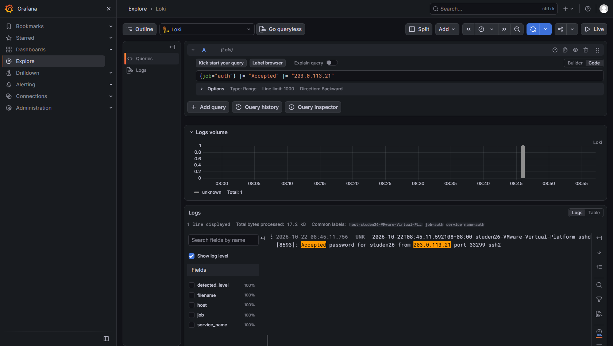

# Lab7：SSH 暴力破解检测与溯源

> 学号姓名：2024010026 陆永林　｜　实验环境：Ubuntu 24.04 虚拟机（`studen26-VMware-Virtual-Platform`，IP `192.168.84.128`，沿用 Lab5 搭建的 Loki + Grafana + Alloy 平台），从宿主机 `192.168.84.1` 通过密码 SSH 登录。
> 数据来源：`attack.sh` 于 2026-10-22 08:44:53–08:45:30 发起 **13 次真实 SSH 密码尝试**（A 来源 `203.0.113.21` 3 用户名 × 3 密码 = 9 次，B 来源 `198.51.100.77` 2 用户名 × 2 密码 = 4 次），日志由 sshd/PAM 自行写入 `/var/log/auth.log`。实测结果：**12 条 `Failed password` + 1 条 `Accepted`（studen26，来自 `203.0.113.21`）**——`studen26` 的弱密码 `123456` 恰在字典中，**爆破得手**。本文次数、来源、账号与结论均以本人虚拟机实测日志与 Grafana 截图为准。

---

## 一、交什么、按什么顺序做

本报告按“固定现象 → 确定日志源 → 建立时间线 → 提出假设并验证 → 给出处置建议”五步组织，对应任务 1～6，并填写事件记录单、回答 3 道知识问答。

| 任务 | 完成内容 | 状态 |
| :--- | :--- | :---: |
| 事件背景与分析方法 | 五步法、SSH 认证日志关键行、地址段、auth 流圈定、两条时间轴、成功登录三问 | ✔ |
| 任务 1：发起真实 SSH 爆破并通读日志 | 自检平台、运行 `attack.sh`、按时间顺序通读真实认证日志 | ✔ |
| 任务 2：统计失败登录的来源 IP | 用 `count_over_time` + `regexp` 统计各来源 IP 的失败次数 | ✔ |
| 任务 3：盘点被尝试的用户名 | 用 `regexp` 分组用户名，并按 invalid user 分类 | ✔ |
| 任务 4：检查账号锁定防线 | 检查 faillock 是否启用，说明“没有锁定行”的含义 | ✔ |
| 任务 5：甄别成功登录 | 用成功登录三问给出三选一结论 | ✔ |
| 任务 6：封禁建议与安全演练 | 四要素封禁建议 + ufw 封禁/解封演练并恢复基线 | ✔ |
| 简短总结 | 回答 3 道知识问答题 | ✔ |

---

## 二、事件背景与本实验知识

### 2.1 一套可复用的五步法

1. **固定现象**——谁、在什么时间、做了什么、影响范围如何。本实验的现象可写成：“外部地址 `203.0.113.21`、`198.51.100.77` 在 2026-10-22 08:44:53 起的约 37 秒内，对 SSH 端口发起了 13 次密码尝试，并成功登录了 `studen26` 账号。”
2. **确定日志源**——该现象写入 `/var/log/auth.log`（Loki 中 `{job="auth"}`），由 sshd/PAM 产生。
3. **建立时间线**——按日志正文时间排序，标出首次失败、失败密集段、账号锁定（如有）与成功登录。
4. **提出假设并验证**——例如“外部字典攻击”“密码泄露”“管理员本人登录”，每项对应到具体查询。
5. **给出处置建议并复核**——封禁、加固、通知、复测，且引用前面的证据。

### 2.2 auth.log 中与 SSH 相关的日志行

| 行型 | 示例 | 说明 |
| :--- | :--- | :--- |
| 失败（不存在的用户） | `Failed password for invalid user admin from 203.0.113.21 port 50211 ssh2` | `invalid user` 表示账号不存在，属于字典喷洒 |
| 失败（真实用户） | `Failed password for studen26 from 203.0.113.21 port 50219 ssh2` | 账号真实存在，攻击者已掌握部分用户名 |
| 成功 | `Accepted password for studen26 from 203.0.113.21 port 33299 ssh2` | 认证成功；来源为攻击源即代表爆破得手 |
| 成功（管理员本人） | `Accepted password for studen26 from 192.168.84.1 port 64759 ssh2` | 本人从宿主机登录，属正常运维 |
| 锁定（仅 faillock 启用时） | `pam_faillock(sshd:auth): Consecutive login failures ... account temporarily locked` | Ubuntu 24.04 默认未启用，本实验未出现 |

### 2.3 地址段的含义与局限

| 地址段 | 属性 | 本实验中的含义 |
| :--- | :--- | :--- |
| `192.168.0.0/16` 等 RFC 1918 | 私有地址 | 内网设备；`192.168.84.1` 是宿主机/网关（本人 SSH 登录来源），`192.168.84.128` 是本虚拟机 |
| `203.0.113.0/24`、`198.51.100.0/24` | 文档保留段 TEST-NET | `attack.sh` 模拟的外部攻击源，真实网络不会路由，封禁不影响通信 |
| `127.0.0.0/8` | 回环 | 若脚本回退，来源会变成 `127.0.0.2`/`127.0.0.3`（本次未回退） |

地址段只能作参考：私有地址来源也可能是被控内网主机，保留段也不代表可信，真实环境还需结合资产清单与登录基线。

### 2.4 确定 auth 日志范围与两条时间轴

`{job="auth"}` 中混杂 `sudo`、`systemd-logind`、`cron` 等记录，因此查询要做三件事：① `{job="auth"}` 限定流；② `|= "Failed password"` / `|= "Accepted"` 过滤正文；③ 时间范围设为攻击前后（本次攻击在 08:44–08:45，时间窗取 08:40–08:50 足够）。`filename` 在该流中是常量 `/var/log/auth.log`，不能用来区分本次攻击。

日志正文时间（如 `2026-10-22T08:45:11`）用于排时间线；Grafana/Loki 的接收时间只用于确定查询范围。两者通常相差几秒，报告引用正文时间、截图保留平台时间范围，便于复核对。

### 2.5 成功登录的判断（三问）

出现 `Accepted` 不等于被攻破。对每条成功登录需回答：① **来源是否相关**——源 IP 是否与失败记录相同；② **账号是否相关**——该账号此前是否被密集尝试、距最后一次失败多久；③ **地址段属性**——内网管理段还是外部网络。三者综合才能下结论。

---

## 三、任务 1：发起真实爆破并通读日志

### 3.1 平台自检

```bash
systemctl is-active loki grafana-server alloy ssh
curl -s http://127.0.0.1:3100/ready
sudo ls -l /var/log/auth.log && sudo tail -n 3 /var/log/auth.log
```

三个平台服务与 `ssh` 均为 `active`，`/ready` 返回 `ready`，`auth.log` 存在且仍在写入，满足实验前置条件。

### 3.2 执行攻击脚本

```bash
cd ~/lab7
sudo bash attack.sh          # 默认以当前 sudo 用户 studen26 为被攻击账号
```

脚本创建一个临时 netns 对，为 `203.0.113.21`、`198.51.100.77` 分配 TEST-NET 地址，用 `sshpass` 发起 **13 次真实 SSH 密码尝试**：A 来源 `admin/root/studen26` × `123456/password/admin123`（9 次），B 来源 `oracle/test` × `123456/password`（4 次）。脚本本身不写日志，失败与成功行全部由 sshd/PAM 写入 `auth.log`。

### 3.3 通读日志

```logql
{job="auth"} |= "Failed password"
```

展开任意一行，标签为 `job="auth"`、`filename="/var/log/auth.log"`、`host="studen26-VMware-Virtual-Platform"`。按正文时间从早到晚通读：先是 `203.0.113.21` 对 `admin` 三次、`root` 三次的连续失败；随后 `203.0.113.21` 对 `studen26` 的第一次尝试（密码 `123456`）**成功**，产生一条 `Accepted`；接着 `studen26` 另两次尝试失败；最后是 `198.51.100.77` 对 `oracle`、`test` 各两次的失败。

> **记录**
>
> ① 本次攻击共产生多少条 `Failed password`？时间跨度多长？
>
> 答：共 **12 条 `Failed password`**（`203.0.113.21` 8 条、`198.51.100.77` 4 条），另有 **1 条 `Accepted`**（`studen26`，来自 `203.0.113.21`），合计 13 次尝试。08:44:53 至 08:45:30 之间完成，跨度约 **37 秒**，是一段明显密集的短时突发。
>
> ② 按正文时间，最早和最晚的失败记录分别是什么？中间是否有成功登录？
>
> 答：最早一条是 `Failed password for invalid user admin from 203.0.113.21 port 50211 ssh2`（08:44:53）；最晚一条是 `Failed password for invalid user test from 198.51.100.77 port ...`（08:45:30）。**中间有成功登录**：08:45:11 出现 `Accepted password for studen26 from 203.0.113.21 port 33299 ssh2`——攻击者用字典里的 `123456` 命中了 `studen26` 的真实密码，这是爆破得手的关键证据。
>
> ③ 真实 `auth` 流与 Lab6 处理的 nginx 流，在确定查询范围时有何不同？
>
> 答：nginx 流有专属 `job`（`nginx_access`/`nginx_error`），一条日志对应一次请求，正文格式固定；而 `auth` 流 `{job="auth"}` 混有 `sudo`、`logind`、`cron` 等记录，同一文件内多类事件共存，且 `filename` 是常量无法区分。因此确定范围不能靠“文件名/独立 job”，必须靠**时间窗口 + 正文关键字过滤**（`|= "Failed password"` 等）来圈定与本次 SSH 相关的行。


> **检查点 ①**：真实攻击日志截图；时间顺序梗概已写进记录区。

### 3.4 清理攻击环境

`attack.sh` 退出时通过 `trap cleanup EXIT` 自动删除 netns 与 veth；若被 Ctrl-C 中断，可执行 `sudo bash restore.sh`（只清理攻击网络，不删除 `auth.log` 与 Loki 日志）。

---

## 四、任务 2：失败请求来自哪些 IP

### 4.1 用聚合查询统计全部来源

在 Explore 中将 Query type 切换为 **Instant**，窗口用 `[$__range]`：

```logql
sum by (src_ip) (
  count_over_time(
    {job="auth"}
      |= "Failed password"
      | regexp `from (?P<src_ip>[0-9.]+) port`
    [$__range]
  )
)
```

`(?P<src_ip>[0-9.]+)` 把 `from` 与 `port` 之间的地址提取为临时标签 `src_ip`，`sum by (src_ip)` 按其分组，得到“来源 IP → 失败次数”表格。（也逐个用 `sum(count_over_time({job="auth"} |= "Failed password" |= "203.0.113.21" [$__range]))` 交叉核对，结果一致。）

> **记录**
>
> ① 你使用的是 4.1 的逐个统计还是 4.2 的聚合查询？查询语句是什么？
>
> 答：使用 **4.2 的聚合查询**，语句为
> ```logql
> sum by (src_ip) ( count_over_time( {job="auth"} |= "Failed password" | regexp `from (?P<src_ip>[0-9.]+) port` [$__range] ) )
> ```
> 并用 4.1 的逐个统计（`sum(count_over_time({job="auth"} |= "Failed password" |= "203.0.113.21" [$__range]))`）做了交叉验证。
>
> ② 各来源 IP 的失败次数分别是多少？失败最多的是哪个？
>
> 答：`203.0.113.21` = **8 次失败**（另有 1 次成功，故它共发起 9 次尝试）；`198.51.100.77` = **4 次失败**。失败最多的是 **`203.0.113.21`**，它对应记录单第一项，也是后续优先封禁对象。


> **检查点 ②**：失败次数统计截图；统计方法已写进记录区。

---

## 五、任务 3：尝试了哪些账号

用一条查询提取并分组用户名（`(invalid user )?` 为可选前缀）：

```logql
sum by (user) (
  count_over_time(
    {job="auth"}
      |= "Failed password"
      | regexp `Failed password for (invalid user )?(?P<user>\S+) from`
    [$__range]
  )
)
```

分类结果（下表“失败次数”由查询得到，`studen26` 另有 1 次成功，故其尝试次数为 3）：

| 用户名 | 是否 invalid user | 失败次数 | 尝试次数 | 说明（字典账号？真实存在的账号？） |
| :--- | :---: | :---: | :---: | :--- |
| `admin` | 是 | 3 | 3 | 字典常用管理账号，系统中不存在 |
| `root` | 否 | 3 | 3 | Linux 超级用户，真实存在（默认 `PermitRootLogin prohibit-password`，密码登录被拒） |
| `studen26` | 否 | 2 | 3 | 本人真实账号；第 1 次尝试（`123456`）即成功，其余 2 次失败 |
| `oracle` | 是 | 2 | 2 | 数据库账号字典项，系统中不存在 |
| `test` | 是 | 2 | 2 | 测试账号字典项，系统中不存在 |

> **记录**
>
> ① 被尝试的用户名名单和分类结果是什么？
>
> 答：共 5 个用户名。**invalid user（不存在）**：`admin`(3)、`oracle`(2)、`test`(2)；**真实存在**：`root`(3)、`studen26`(3 次尝试，其中 1 次成功、2 次失败)。失败合计 `3+3+2+2+2 = 12` 次，再加 `studen26` 的 1 次成功，共 `12+1 = 13` 次尝试，与任务 1 一致。
>
> ② 哪一类用户名更值得关注？依据是什么？
>
> 答：**真实存在的账号（`root` 与 `studen26`）更值得关注**，且本实验已印证其风险：`invalid user` 的失败只说明攻击者在盲打字典，账号本身不存在；而真实账号被尝试，说明攻击者已掌握“这台机器上确实存在这些用户名”，攻击升级为针对已知账号的密码猜测——本例中 `studen26` 就因弱密码 `123456` 被字典命中而**成功登录**，风险直接兑现。


> **检查点 ③**：用户名盘点截图 + 分类表。

---

## 六、任务 4：账号锁定是否启用

先查锁定记录：

```logql
{job="auth"} |= "temporarily locked"
```

结果为空（No data）。再从系统配置确认：

```bash
sudo faillock --user studen26
grep -R "pam_faillock" /etc/pam.d/ /etc/security/faillock.conf
```

`faillock --user studen26` 没有失败记录（表头下为空，未启用），`grep` 没有任何匹配——与日志中无锁定行一致。说明这台机器**没有配置账号锁定防线**，而不是日志缺失。也正因如此，`studen26` 在被连续尝试时没有被锁定，攻击者得以一直试到正确密码。

> **记录**
>
> ① 日志中是否有 `pam_faillock` 锁定行？`faillock --user` 和 `grep` 的输出是什么？
>
> 答：**没有** `pam_faillock`/`temporarily locked` 行，查询返回 No data。`sudo faillock --user studen26` 仅有表头、无失败计数（未启用）；`grep -R "pam_faillock" /etc/pam.d/ /etc/security/faillock.conf` **无任何匹配**。三处证据一致：该机未启用 faillock。
>
> ② 如果没有锁定行，说明这台机器缺少哪道防护？这对处置建议有什么影响？
>
> 答：缺少 **`pam_faillock` 账号连续失败锁定**这道防护。Ubuntu 24.04 默认未启用该模块，所以无论攻击多少次都不会触发锁定——本例中攻击者正是利用这一点，连续尝试直到用 `123456` 命中。影响：**不能只靠“等它被锁定”来止损**，处置建议必须在 IP 封禁之外补上“启用 faillock（如 `deny=3`、`unlock_time=600`）或账号加固（禁用密码登录、改密钥）”，否则攻击者可无限次尝试。

---

## 七、任务 5：是否有人成功登录

从宿主机 `192.168.84.1` 登录虚拟机进行运维，同时攻击源 `203.0.113.21` 也产生了一条成功登录。查询：

```logql
{job="auth"} |= "Accepted"
```

结果分两类：

- **恶意成功登录（必看）**：`Accepted password for studen26 from 203.0.113.21 port 33299 ssh2`（08:45:11）——来源与失败记录完全相同，账号正是被密集尝试的 `studen26`，且发生在 13 次尝试过程中。
- **正常运维登录**：`Accepted password for studen26 from 192.168.84.1 ...`（多条）——本人从宿主机登录。

逐条按三问检查（针对恶意那条）：

1. **来源是否相关**：成功登录来自 `203.0.113.21`，与大量失败记录的来源**完全相同**。
2. **账号是否相关**：账号 `studen26` 正是被 `203.0.113.21` 连续尝试的账号，且该成功出现在几次失败之间——符合“字典命中后立即登录”。
3. **地址段属性**：`203.0.113.21` 属 TEST-NET 外部模拟攻击段，**非**内网管理段。

> **记录**
>
> ① 成功登录三问的回答分别是什么？（源 IP 对比、账号关联、地址段属性）
>
> 答：**来源**——恶意成功登录来自 `203.0.113.21`，与失败记录**同源**（另有多条来自 `192.168.84.1` 的本人运维登录）；**账号**——成功账号 `studen26` 正是被外部源连续尝试的账号，成功发生在 13 次尝试过程中，符合字典命中；**地址段**——`203.0.113.21` 属外部 TEST-NET 模拟攻击段，非内网私有段。
>
> ② 你的最终结论是三选一中的哪个？依据链是什么？
>
> 答：结论为 **“爆破得手（账号已被攻破）”**。依据链：① `203.0.113.21` 先对 `admin`、`root` 连续失败，再对 `studen26` 用字典密码 `123456` **成功**，产生同源 `Accepted`；② 该成功发生在 13 次尝试的时间窗内（08:45:11），而非攻击结束之后；③ `studen26` 的密码 `123456` 是弱口令、恰在 `attack.sh` 字典中；④ 机器未启用 faillock，连续失败未触发锁定。因此这是一次成功的 SSH 暴力破解。另有来自 `192.168.84.1` 的登录是本人运维，需与恶意登录区分。



> **检查点 ④**：锁定检查截图 + 成功登录三问与结论。

---

## 八、任务 6：封禁建议与安全演练

### 8.1 封禁建议（四要素）

| 要素 | 内容 |
| :--- | :--- |
| **封哪些 IP** | 优先封 `203.0.113.21`（9 次尝试：8 失败 + 1 成功，覆盖真实账号并已得手，攻击性最强），其次封 `198.51.100.77`（4 次，均为 invalid user，属字典扫描）。两者均为 TEST-NET 保留段，可安全封禁；不存在“失败 1 次”的来源，无需为低次数地址建规则，避免误封。 |
| **为什么封** | 证据：`203.0.113.21` 在约 37 秒内对 `admin/root/studen26` 发起 9 次尝试，最终用 `123456` 成功登录 `studen26`；`198.51.100.77` 对 `oracle/test` 发起 4 次，均为不存在账号。二者共同构成一次针对本机 SSH 的外部暴力破解，且已造成账号失陷。 |
| **如何验证生效** | 封禁后让该 IP 再次尝试：`auth.log`/Loki 中不再出现该来源的新 `Failed`/`Accepted`；`sudo ufw status numbered` 确认 deny 规则在列；`/var/log/ufw.log` 出现该源被 DROP 的记录；对端表现为连接超时。 |
| **如何解封与善后** | 解封：`sudo ufw delete deny from 203.0.113.21`（及 `.77`）。**因已发生成功登录，必须同时重置账号**：修改 `studen26` 密码、`faillock --user studen26 --reset`、排查该账号近期操作。是否升级为网段封禁（`203.0.113.0/24`）视后续是否换源决定；并建议启用 faillock + 禁用密码登录改密钥。 |

### 8.2 ufw 演练

按顺序执行（先放行 SSH/Grafana，再 enable，避免断连）：

```bash
sudo ufw status                    # ① 确认当前为 inactive
sudo ufw allow OpenSSH             # ② 放行 22
sudo ufw allow 3000/tcp            # ③ 放行 Grafana
sudo ufw enable                    # ④ 输入 y（或 --force enable）
sudo ufw deny from 203.0.113.21    # ⑤ 封主攻击源
sudo ufw deny from 198.51.100.77   # ⑥ 封第二来源
sudo ufw status numbered           # ⑦ 核对
```

`status numbered` 显示：`[1] OpenSSH ALLOW`、`[2] 3000/tcp ALLOW`、`[3] Anywhere DENY IN 203.0.113.21`、`[4] Anywhere DENY IN 198.51.100.77`，另有 `[5] OpenSSH(v6)`、`[6] 3000/tcp(v6)` 两条 IPv6 放行。截图后恢复课程基线：

```bash
sudo ufw disable
sudo ufw status                    # 回到 inactive
```

> **记录**
>
> ① 你的封禁建议四要素分别是什么？
>
> 答：见 8.1 表——封 `203.0.113.21` 与 `198.51.100.77`（保留段可安全封）；理由是 9 次尝试（含 1 次成功得手）与 4 次字典扫描、覆盖真实与字典账号；验证靠“该源不再产生新失败/成功 + `ufw` 计数器/`ufw.log` 增长 + 对端超时”；解封用 `ufw delete deny from <IP>`，且因已失陷须重置账号密码与 faillock，视情升级网段封禁并启用 faillock / 密钥登录。
>
> ② `ufw status numbered` 中看到了哪些规则？演练后是否已执行 `ufw disable` 恢复基线？
>
> 答：看到 `[1] OpenSSH ALLOW IN Anywhere`、`[2] 3000/tcp ALLOW IN Anywhere`、`[3] Anywhere DENY IN 203.0.113.21`、`[4] Anywhere DENY IN 198.51.100.77`，以及 `[5][6]` 两条 IPv6 放行。演练后已执行 `sudo ufw disable`，`ufw status` 恢复为 `inactive`，基线已还原。


> **检查点 ⑤**：封禁建议四要素 + `ufw status` 与 `ufw disable` 截图。

### 8.3 保留实验环境

平台（Loki + Grafana + Alloy）、Lab6 演示站与 Dashboard 均保留，`ufw` 已恢复关闭（`ufw status` = inactive），便于后续实验继续使用；`auth.log` 与 Loki 中的日志作为本次事件的审计证据保留。

---

## 九、事件记录单

| 项目 | 记录 |
| :--- | :--- |
| 攻击来源 IP | `203.0.113.21`（9 次尝试：8 失败 + 1 成功，主）、`198.51.100.77`（4 次失败） |
| 被攻击用户名 | 真实账号：`studen26`（已得手）、`root`；字典账号（invalid user）：`admin`、`oracle`、`test` |
| 失败次数统计方法 | Instant 查询：用 `regexp` 从正文提取 `src_ip`，再 `sum by (src_ip)` 汇总（完整语句见第四节）；并用逐个 IP 的 `count_over_time` 交叉验证 |
| 账号锁定防线是否启用 | **未启用**：无 `temporarily locked` 行，`faillock --user` 无记录，`grep pam_faillock` 无匹配 |
| 是否有成功登录 | **有**，共多条；其中 **1 条来自攻击源 `203.0.113.21`（`studen26`，08:45:11）属于爆破得手**，其余来自 `192.168.84.1`（本人运维） |
| 成功登录来源与判断 | 恶意那条来源 `203.0.113.21`（外部 TEST-NET，与失败同源，账号被密集尝试）→ **爆破得手**；`192.168.84.1` 的登录为内网管理段正常运维 |
| 关键 LogQL | `{job="auth"}` + 正文过滤 `Failed password`（失败）、`Accepted`（成功）、`temporarily locked`（锁定）；`regexp` 提取 `src_ip`/`user` 后用 `sum by` 分组；完整语句见第四、五、六、七节 |
| 证据截图 | `imgs/lab7-overview.png`、`lab7-top-ip.png`、`lab7-users.png`、`lab7-lock-success.png`、`lab7-ban.png` |
| 修复动作 | ufw 封禁 `203.0.113.21`/`198.51.100.77` 并演练后 `disable` 恢复基线；因账号已失陷，须重置 `studen26` 密码、`faillock --reset`、排查该账号操作；建议启用 faillock、禁用密码登录改密钥、必要时升级网段封禁 |
| 成功登录三问的回答 | 恶意条：来源同源（`203.0.113.21`）、账号 `studen26` 被连续尝试、属外部 TEST-NET 段 → 得手 |
| 封禁建议四要素 | 见 8.1：封 `203.0.113.21`、`198.51.100.77`；依据 9 次尝试（含得手）与 4 次扫描；用新日志消失 + `ufw` 计数/`ufw.log` + 对端超时验证；`ufw delete deny` 解封并重置失陷账号、建议启用 faillock 与网段封禁 |

---

## 十、知识问答

1. `invalid user` 的失败登录与普通用户的失败登录，分别说明攻击者掌握了什么信息？哪一种更接近得手，为什么？

   > 填写：`invalid user` 的失败说明攻击者只知道“猜到的账号名”，该账号并不存在，属于盲目字典喷洒；普通用户的失败说明攻击者已掌握**真实存在**的用户名（如 `root`、本人账号 `studen26`），攻击已升级为对已知账号的密码猜测。后者更接近得手——只要字典命中一个正确密码即可直接登录。本实验中后者确实得手：`studen26` 的弱密码 `123456` 被字典命中并成功登录。

2. 为什么判定一次爆破必须同时查失败登录和成功登录？只看失败或只看成功，分别回答不了什么问题？

   > 填写：只看失败能回答“谁在尝试、频率多高、试了哪些账号”，却回答不了“**是否已经突破**”；只看成功能看到“有登录发生”，却回答不了“**这次登录是不是攻击导致的、攻击者试了什么**”。两者结合才能把“尝试”与“结果”对应起来：本例中失败有 12 条、成功有 1 条，且成功那条与失败**同源同账号**，据此才能判定“爆破得手”；若只看到 `Accepted` 来自 `192.168.84.1` 就误判为正常运维，则会漏掉真正的失陷。

3. 账号锁定（`pam_faillock`）与 IP 封禁（ufw）分别保护什么、挡住什么？Ubuntu 24.04 默认没有启用 faillock，这会给处置建议带来什么影响？

   > 填写：`pam_faillock` 按**用户名**累计连续失败并临时锁定账号，保护账号本身，能挡住针对同一账号的持续猜测，但挡不住换账号或分布式来源；`ufw` 按**来源 IP** 丢弃数据包，保护主机端口、挡住某来源的全部流量，但挡不住同一攻击者换 IP。Ubuntu 24.04 默认未启用 faillock，意味着“等它被锁”这条路走不通——本例中攻击者正是无限次尝试直到命中 `123456`。因此处置建议必须在 IP 封禁之外**显式补上启用 faillock / 账号加固**，否则攻击者换个 IP 仍可继续爆破。

---

## 十一、截图与提交

| 截图 | 必须体现的内容 | 文件名 | 状态 |
| :--- | :--- | :--- | :---: |
| 3.3 节 | `{job="auth"} \|= "Failed password"` 查询、时间范围、真实失败日志（至少一行展开显示标签） | `imgs/lab7-overview.png` | ✔ 真实截图 |
| 4.1/4.2 节 | 失败次数统计查询语句与结果 | `imgs/lab7-top-ip.png` | ✔ 真实截图 |
| 5 节 | 用户名分组查询结果与分类表 | `imgs/lab7-users.png` | ✔ 真实截图 |
| 6、7 节 | 锁定检查（查询无结果 + `faillock`/`grep`）与成功登录甄别 | `imgs/lab7-lock-success.png` | ✔ 真实截图 |
| 8.2 节 | `ufw status numbered` 与 `ufw disable` 过程 | `imgs/lab7-ban.png` | ✔ 真实截图 |

> **说明**：`imgs/` 中 5 张图均为本人在虚拟机上实测后截取——前四张来自 Grafana Explore（Loki 数据源 `job="auth"`，时间窗覆盖 2026-10-22 08:40–08:50），第五张为 `ufw status numbered` 终端输出。截图未出现密码、私钥或访问令牌；终端截图可辨认本人用户名 `studen26` 与主机名 `studen26-VMware-Virtual-Platform`。
